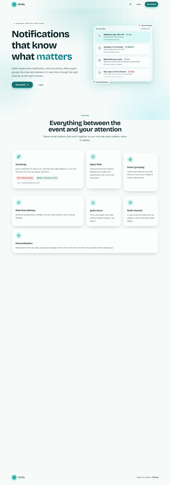
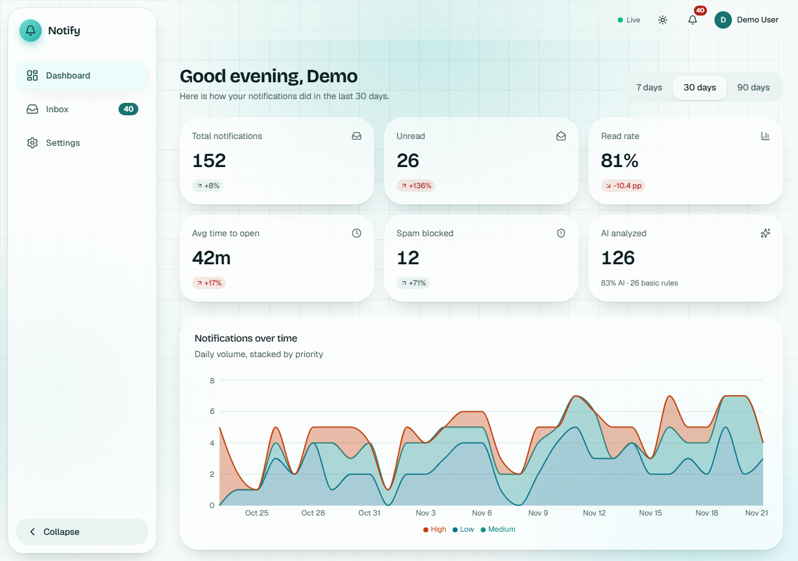
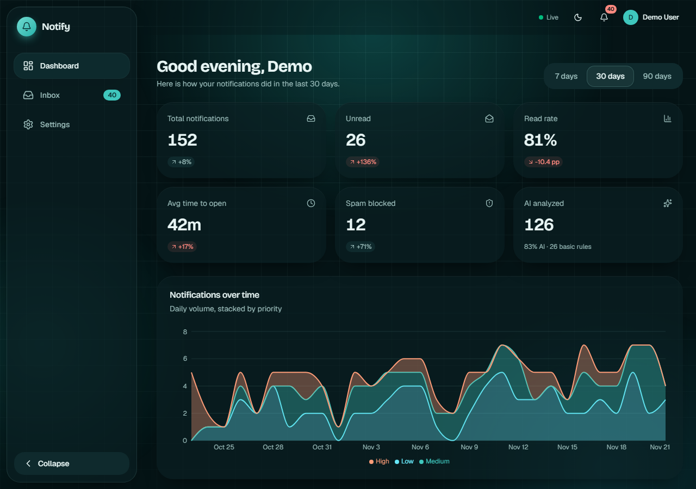
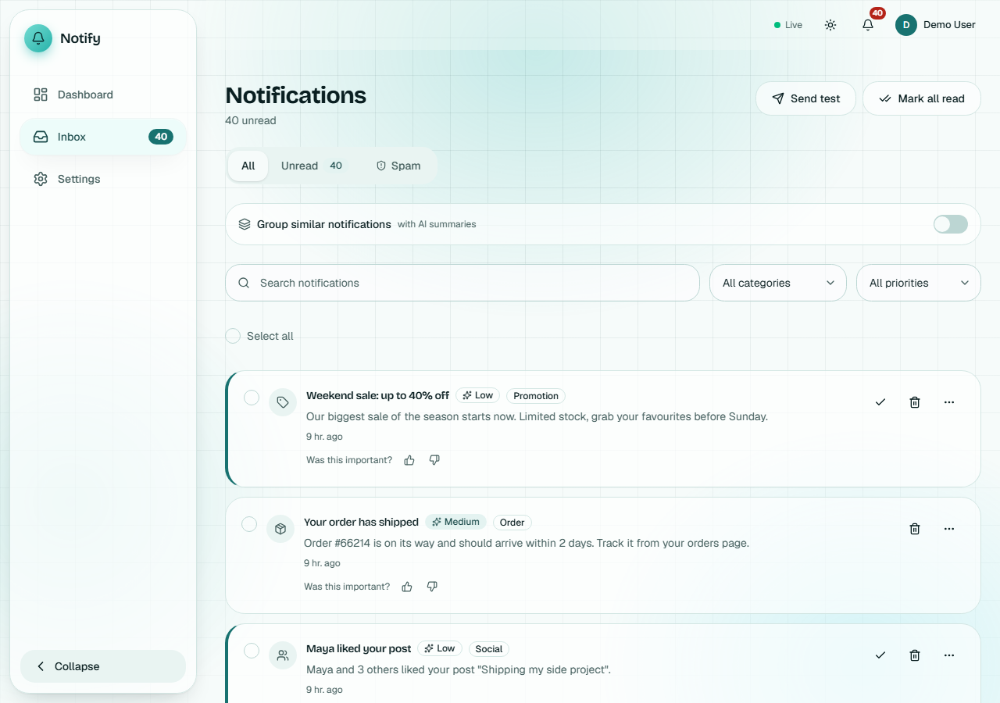
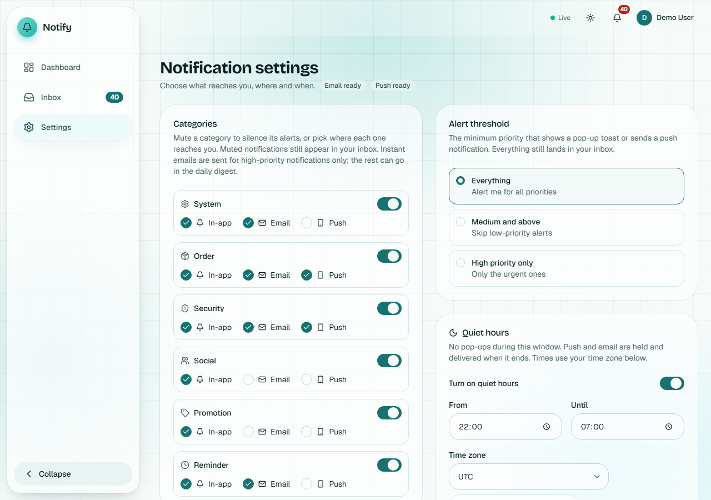
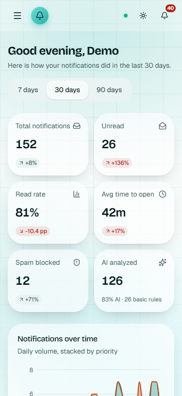
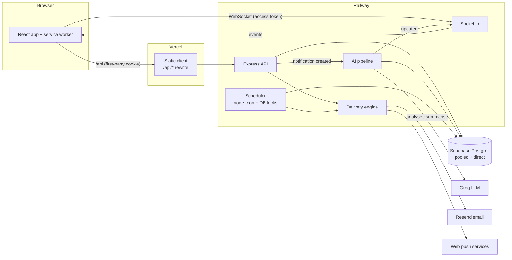

# Notify: AI-Based Real-time Notification System

> Notifications that know what matters. AI ranks priority, filters spam and groups the noise, then delivers in real time through the right channel at the right moment.

**Live demo:** _add your Vercel URL here after deploying_ · **Demo login:** `demo@notify.dev` / `Demo1234!` (created by `npm run seed:demo`; email and push are disabled for this shared account)



| Dashboard (light) | Dashboard (dark) |
|---|---|
|  |  |

| Inbox | Settings | Mobile |
|---|---|---|
|  |  |  |

## Features

- **AI priority and categories.** Every notification is analysed by an LLM (High / Medium / Low, with a one-line reason). Your own choice always wins.
- **Spam and prompt-injection filter.** Scams are quarantined in a Spam tab with a one-click "Not spam".
- **Smart grouping with AI summaries.** Twelve "liked your photo" notifications become one card with a summary.
- **Real-time everywhere.** Socket.io pushes new, updated, read and deleted events to every open tab; a 30 s polling fallback covers dropped connections.
- **Multi-channel delivery.** In-app, email (Resend) and web push (VAPID), per category, with retries and an idempotent delivery log.
- **Quiet hours and daily digest.** Time-zone aware; held notifications are released when quiet hours end.
- **Personalization.** Behaviour (opened, clicked, dismissed) and thumbs up/down feedback nudge priority by at most one level.
- **Analytics dashboard.** Volume by priority, category mix, delivery success per channel, engagement, trends against the previous period, live updates.
- **Secure auth.** 15-minute access token in memory, rotating httpOnly refresh cookie (stored hashed), cross-tab refresh lock.
- **Production hardening.** Rate limits, Helmet, compression, sanitized structured logs, RLS on every table, graceful shutdown, DB lease locks for cron jobs.
- **Polished UI.** Light / dark / system theme, responsive down to 375 px, WCAG-AA contrast (axe: 0 violations), reduced-motion support.

## Tech stack

            

UI: sea green design system (`#20B2AA` scale, 50-950, light and dark), one global grid background, Framer Motion (page transitions, sidebar, lists), GSAP ScrollTrigger (landing reveals, lazy-loaded), CSS marquee, mobile-first layouts.

React, TanStack Query, shadcn/ui (Base UI), Recharts, React Hook Form + Zod on the client. Express 5, Prisma 7 (`@prisma/adapter-pg`), Zod, node-cron, web-push, React Email on the server.

## Architecture



**Why a rewrite?** Vercel and Railway are different sites, so a refresh cookie set by the API would be a blocked third-party cookie. The client calls `/api/*` on its own domain and Vercel proxies it to Railway, which makes the cookie first-party (`SameSite=Lax`). Socket.io connects straight to Railway because it authenticates with the access token and Vercel cannot proxy WebSockets.

## How the AI pipeline works

1. `POST /api/notifications` stores the row immediately with `aiStatus = PENDING` and a provisional rule-based priority, and returns. **The request never waits for the LLM.**
2. An in-process event starts the analysis in the background: a content-hash cache, a per-user rate limit, then one Groq call (JSON mode, validated with Zod, one retry on invalid output, timeout and backoff on 429/5xx).
3. On success the row becomes `DONE` and the client receives `notification:updated` over Socket.io. If Groq is unavailable or the output is invalid, deterministic rules produce the result and the row becomes `FALLBACK`, so the app always works without AI.
4. Personalization may shift the priority by one level, the delivery engine decides the channels (preferences, quiet hours, minimum priority), and group summaries are cached per group signature.

## Local setup

Requirements: Node 22+, a Postgres database (Supabase, or `docker run -p 5432:5432 -e POSTGRES_PASSWORD=postgres postgres:16`).

```bash
cd server && npm install && cp .env.example .env   # fill in the values
npm run prisma:deploy                               # apply migrations
npm run dev                                         # http://localhost:5000

cd client && npm install && cp .env.example .env
npm run dev                                         # http://localhost:5173

cd server && npm run seed:demo                      # optional demo data
```

Without `GROQ_API_KEY`, `RESEND_API_KEY` or VAPID keys the app still runs: AI uses the rule-based fallback and the channels show "not configured".

### Scripts (server)

| Script | What it does |
|---|---|
| `npm run dev` | API with hot reload |
| `npm run build` / `npm start` | Generate Prisma client, compile, run `dist/server.js` |
| `npm run prisma:deploy` | Apply migrations (uses `DIRECT_URL`) |
| `npm run seed:demo` | Demo user + ~75 days of data (`--force` required in production) |
| `npm test` | Unit and integration tests |

### Testing

`npm test` runs 77 tests with the Node test runner: AI parsing and fallback, delivery decisions, retries and idempotency, digest, analytics aggregation, demo-account guard and log sanitizing. Database tests only run when `TEST_DATABASE_URL` is set (use a disposable database, never production). CI runs everything against a Postgres service container.

## Environment variables

**Server** (`server/.env`, see `server/.env.example`)

| Name | Purpose |
|---|---|
| `NODE_ENV`, `PORT` | Runtime mode and port (Railway sets `PORT`) |
| `DATABASE_URL` | Supabase pooled connection (port 6543, `?pgbouncer=true`) used at runtime |
| `DIRECT_URL` | Supabase direct/session connection (port 5432) used by migrations |
| `DB_POOL_MAX` | Max pooled connections (use 5 on the Supabase free tier) |
| `CLIENT_URL` | Allowed web origin(s), comma separated (CORS, Socket.io, email links) |
| `PUBLIC_API_URL` | Public URL of this API (unsubscribe links) |
| `TRUST_PROXY` | Trusted proxy hops (1 behind Railway, 2 behind Vercel rewrite + Railway) |
| `COOKIE_SAMESITE` | `lax` (default, via rewrite) or `none` (direct cross-site API) |
| `JWT_ACCESS_SECRET`, `JWT_REFRESH_SECRET` | Token signing secrets (32+ chars, different) |
| `ACCESS_TOKEN_TTL_MINUTES`, `REFRESH_TOKEN_TTL_DAYS` | Token lifetimes |
| `GROQ_API_KEY`, `GROQ_MODEL_FAST`, `GROQ_MODEL_SMART` | AI (optional). Defaults: `openai/gpt-oss-20b`, `openai/gpt-oss-120b` |
| `AI_TIMEOUT_MS`, `AI_USER_LIMIT_PER_MIN` | LLM timeout and per-user budget |
| `RESEND_API_KEY`, `EMAIL_FROM` | Email (optional) |
| `VAPID_PUBLIC_KEY`, `VAPID_PRIVATE_KEY`, `VAPID_SUBJECT` | Web push (optional). `npx web-push generate-vapid-keys` |
| `SCHEDULER_ENABLED` | Run cron jobs on this instance |

**Client** (`client/.env`)

| Name | Purpose |
|---|---|
| `VITE_API_URL` | API base. `http://localhost:5000/api` locally, `/api` in production |
| `VITE_SOCKET_URL` | Socket.io server origin (production: the Railway URL) |
| `VITE_SITE_URL` | Optional absolute site URL for Open Graph tags (Vercel provides it automatically) |

## Deployment

Frontend on Vercel (root `client`), backend on Railway (root `server`), database on Supabase. Step-by-step instructions are in [docs/DEPLOY.md](docs/DEPLOY.md) and a post-deploy checklist is in [docs/SMOKE_TEST.md](docs/SMOKE_TEST.md).

- Railway runs `prisma migrate deploy` as a pre-deploy step, then `node dist/server.js`; health check `/api/health` (tolerates a Supabase cold-start retry); SIGTERM drains sockets and closes the pool.
- Cron jobs take a DB lease lock first, so a second instance never double-sends; scaling Socket.io later needs one adapter line (see `server/src/sockets/index.ts`).
- Row Level Security is enabled on every table with no policies: the Supabase Data API cannot read anything, while the server connects as the table owner.

## What I would do next

Redis adapter for multi-instance Socket.io, a verified Resend domain for real multi-user email, per-user digest time-zone detection, and end-to-end browser tests in CI.

## Resume bullets

- Built and shipped a full-stack AI notification platform (React 19, Express 5, Prisma, Socket.io, Supabase Postgres) with real-time multi-tab delivery, LLM-based priority/spam/grouping on Groq, and a rule-based fallback that keeps the product working when the AI is down.
- Designed a non-blocking AI pipeline (content-hash cache, per-user rate limit, Zod-validated JSON, retries) and an idempotent multi-channel delivery engine (in-app, Resend email, web push) with quiet hours, retries with backoff and lease-locked cron jobs safe for multiple instances.
- Delivered an analytics dashboard (SQL aggregation with trends, 4 charts, live updates) and a polished, accessible UI: Lighthouse 88-91 performance and 100 accessibility / SEO, zero axe violations in light and dark themes, responsive from 375 px.
- Hardened for production: first-party cookie auth across Vercel and Railway via rewrites, rotating hashed refresh tokens with a cross-tab lock, rate limiting, RLS on all tables, sanitized structured logs, 77 automated tests and a GitHub Actions pipeline with a Postgres service container.
